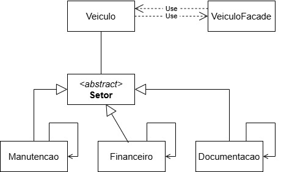

# Padrão Facade — Liberação de Veículos para Viagem

## Sobre a atividade

O projeto utiliza o padrão de projeto **Facade** para simplificar o processo de liberação de veículos para viagem. A fachada centraliza a verificação de pendências nos setores de documentação, manutenção e financeiro, permitindo que o veículo solicite a liberação sem precisar acessar cada setor diretamente.

## Estrutura

- **Veiculo:** solicita a liberação para viagem.
- **VeiculoFacade:** coordena a verificação de pendências.
- **Setor:** classe abstrata que reúne os métodos de registro e consulta de veículos com pendências.
- **Documentacao:** representa o setor responsável pela documentação.
- **Manutencao:** representa o setor responsável pela manutenção.
- **Financeiro:** representa o setor responsável pelas pendências financeiras.

Os três setores utilizam o padrão **Singleton**, garantindo uma única instância de cada classe.

## Testes

A classe `VeiculoTest` verifica os seguintes cenários:

- Veículo com pendência na documentação.
- Veículo com pendência na manutenção.
- Veículo com pendência financeira.
- Veículo sem pendências e liberado para viagem.

## Diagrama de Classe
